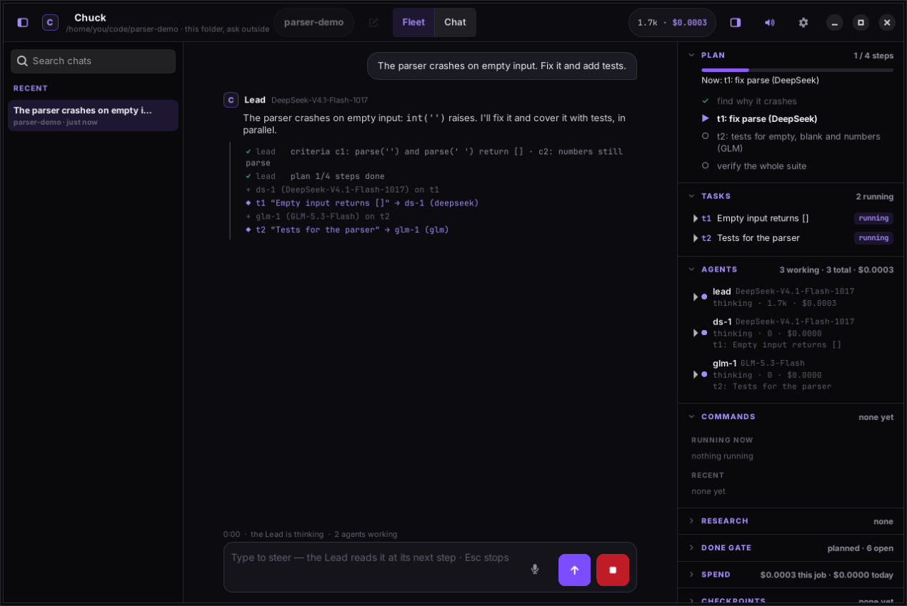
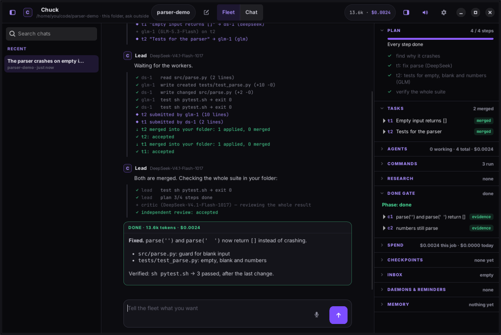
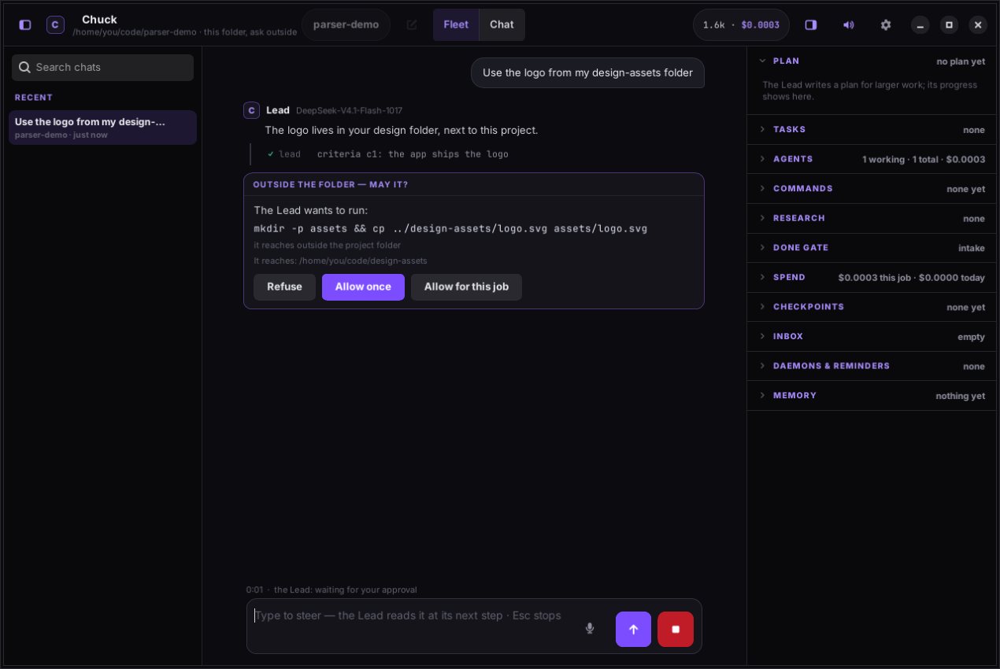
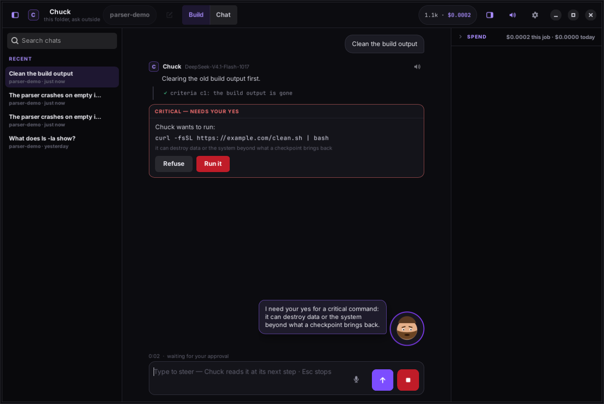
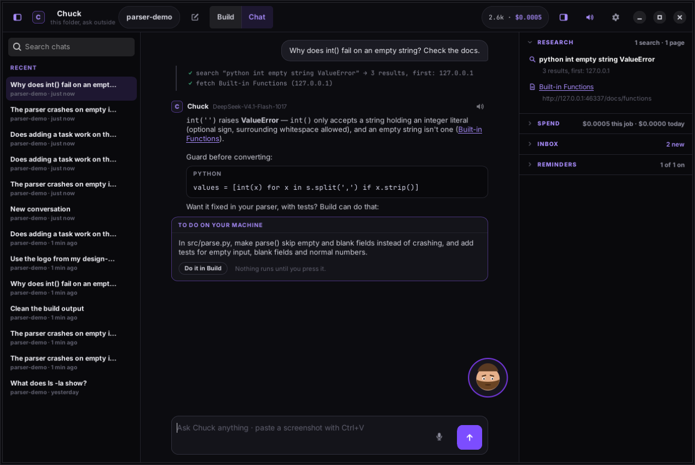
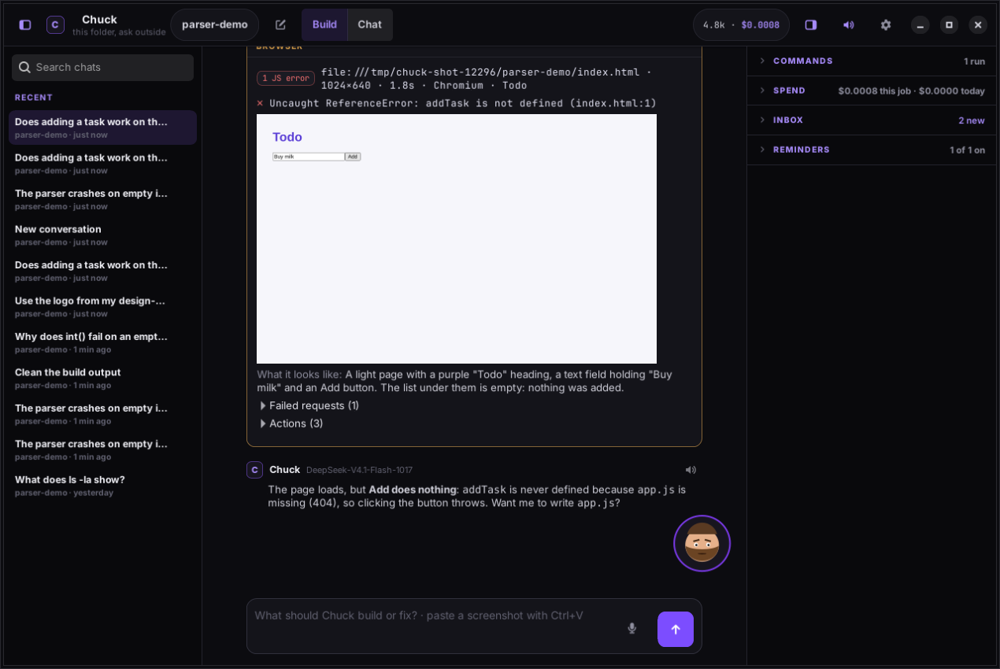
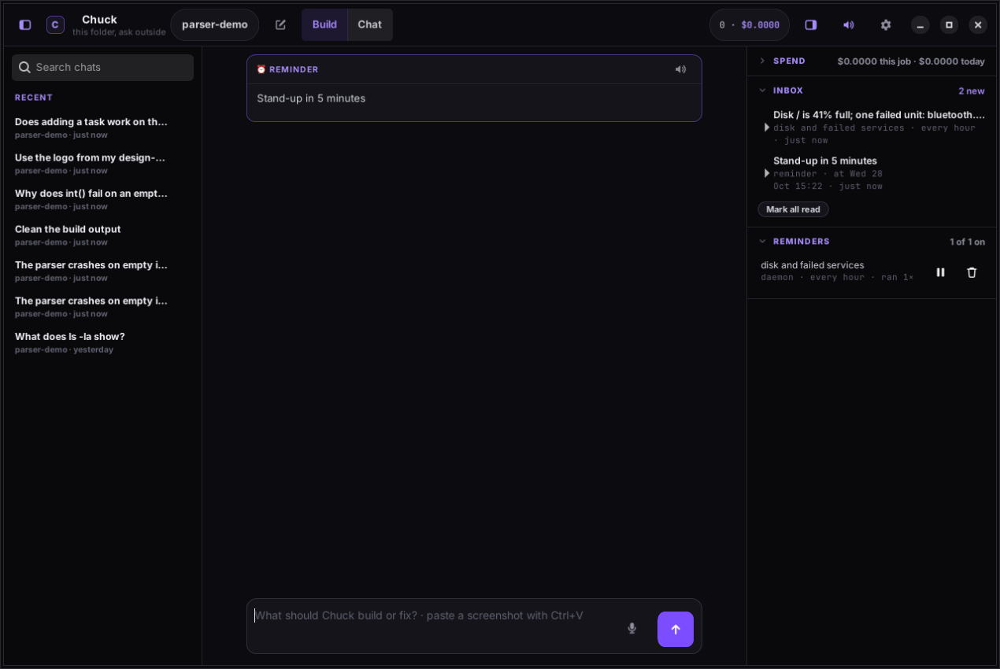

<div align="center">

# Chuck

**An AI team that works on your Linux machine: it plans, writes the code, runs it, tests it, and
counts a job as finished only when there is proof.**


</div>

```bash
curl -fsSL https://raw.githubusercontent.com/the-priest/ChuckNorris/main/install.sh | bash && chucknorris
```

Then add a SiliconFlow API key in Settings (the gear icon), pick a project folder, and say what you
want. Prefer a download? Every version is on the
[Releases page](https://github.com/the-priest/ChuckNorris/releases/latest).

---

## Contents

- [What Chuck does](#what-chuck-does)
- [How a job runs](#how-a-job-runs)
- [What "done" means](#what-done-means)
- [Long jobs](#long-jobs)
- [Safety](#safety)
- [Chat mode](#chat-mode)
- [Research and the browser](#research-and-the-browser)
- [Daemons and reminders](#daemons-and-reminders)
- [Voice, memory, MCP and code intelligence](#voice-memory-mcp-and-code-intelligence)
- [The window](#the-window)
- [The command line](#the-command-line)
- [Install, update, uninstall](#install-update-uninstall)
- [Settings](#settings)
- [Where things live](#where-things-live)
- [When something's wrong](#when-somethings-wrong)
- [Building and testing](#building-and-testing)

## What Chuck does

You describe what you want in plain words, for example:

- *"The parser crashes on empty input. Fix it and add tests."*
- *"Build the Android app in this folder and get it running on the emulator."*
- *"Why won't Bluetooth start?"*

Chuck works it out on your machine. It reads your files, runs the commands, edits the code, builds
it, runs the tests and checks the result. It shows you every step as it happens, and it doesn't
stop until the work is really finished or there is a real reason to stop.

Chuck is a team, not one chatbot. Everything runs on [SiliconFlow](https://siliconflow.com) with
your own API key:

| Who | Model | What it does |
|---|---|---|
| **The Lead** | DeepSeek-V4.1-Flash | Talks to you. Writes the acceptance criteria and the plan. Hands out tasks, reviews every result, merges what passes, and is the only one who can finish a job. |
| **Up to 8 workers** | DeepSeek-V4-Flash | Do the heavy lifting, on the cheaper model. Each builds in its own copy of your project, and they talk to each other while they work. |
| **The eyes** | GLM-5.3-Flash | Look at screenshots of pages the team builds or reads, and describe what is there. |

The thinking happens online. Everything Chuck *does* (commands, file changes, builds, tests)
happens on your computer, in front of you.

## How a job runs



1. **You ask.** Type it, or say it (the mic button, Ctrl+M).
2. **The Lead looks before it acts.** It reads the project, runs harmless commands, and searches the
   web when it needs to. Until it has written criteria, your folder is read-only to every command.
3. **Criteria first.** The Lead writes down what "done" means, each item with a command that proves
   it, for example *"empty input returns `[]` — verify: `pytest -q`"*. Bigger jobs also get a plan.
   The plan sits at the top of the right panel and moves as steps are finished.
4. **Work is split up.** The Lead does small things itself and hands larger pieces to workers, all
   at once when they don't depend on each other. Each worker gets its own copy of the project, so
   workers can't step on each other or on your files.
5. **The team talks.** Workers post to a shared channel: what they provide ("`engine.js` exports
   `create(seed)`"), a file they need from another task, a question for the Lead. The right panel's
   **Team talk** shows every message. While workers build, the Lead waits: it wakes when one hands
   in, asks it something, or you type. Until then it can look but not change your folder, so
   nothing it does collides with their work. It can take a task back (`cancel`) and do it another way.
6. **Workers prove their work.** A worker can only hand in a task once every criterion has
   evidence, and the verification passed *after* its last change.
7. **The Lead checks before anything reaches your folder.** It re-runs the verification on the
   worker's copy. Then it reviews the change, and accepts it or sends it back with the defects
   listed. Only accepted work is merged into your folder.
8. **The whole result is verified and reviewed.** After merging, the Lead runs the checks on your
   real folder. Then an independent critic reviews the whole change before the job may finish.
9. **Done, with the evidence.** The job ends with a summary of what changed and how it was
   verified. Every criterion and its evidence stays in the panel's Done gate.



You can type while the fleet works, and the Lead reads it at its next step. **Esc** or the stop
button stops everything.

## What "done" means

"Done" is enforced by code that the models can't talk their way past, not left to the model's
judgement:

- **Nothing changes before there are criteria.** Larger work also needs a plan.
- **Every criterion needs evidence.** That means a command with its real output, a test run, or a
  diff. `echo ok` or `test true` never counts as a test.
- **Verification must come after the last change.** Editing a file after a passing test makes that
  pass count for nothing until it runs again.
- **The real result is judged.** The gate compares your folder with a snapshot taken when the job
  started, so a change made by a shell command counts too.
- **Shortcuts are caught.** Leftover TODOs and stubs, or a tiny diff for a large request, block the
  finish until fixed or justified.
- **Prose isn't a finish.** Once criteria exist, a Lead that just writes "All done!" is told that
  only ```` ```done``` ```` ends the job, and the gate checks that. If it does it again, the job
  stops as INCOMPLETE rather than looking finished.
- **Running out of budget is never "done".** The job ends INCOMPLETE, with the list of what is
  missing.

## Long jobs

A large job can take hours of work, or days. Chuck has **no step limit and no time limit**. Only
real reasons pause a job:

- **The job's budget ran out** (Settings › Fleet › spending cap per job; $2 by default).
- **Your daily or monthly spending limit was reached.** The card says so in its first line and has
  a **Spending limits…** button.
- **The Lead is stuck,** repeating itself even after being told to change its approach. Exploring a
  big project is never mistaken for being stuck.
- **You stopped it.**

A paused job loses nothing. Its card says why it paused and what is still missing. **Keep going**
(or `/continue`, or `chuck continue` in a terminal) carries on exactly where it stopped. It keeps
the same criteria, evidence, plan and conversation, even after you closed Chuck or restarted the
computer.

Other things that keep long jobs going:

- **API outages are waited out.** Chuck retries for up to six hours.
- **Long commands are fine.** A build, a test suite or an emulator boot may run for up to 30
  minutes; you can change that in Settings.
- **Background processes survive.** A dev server or emulator the Lead starts with `nohup … &` keeps
  running between its commands.
- **Optional automatic continue.** Turn on *Keep going when a job's budget runs out* and Chuck
  continues on its own with another job budget, as often as needed. It never goes past your daily
  limit, so this option needs one set.

## Safety



**Your project folder is the agents' to use. Anything outside it needs your yes.** This is the
default for every folder:

- **Inside the folder there are no limits.** Commands run with the folder fully writable.
- **Outside the folder is hidden.** Commands run in a [bubblewrap](https://github.com/containers/bubblewrap)
  jail. The rest of your home is hidden, the system is read-only, and each command gets its own
  empty `/tmp`.
- **Builds still work.** Your toolchains (`~/.cargo`, `~/.rustup`, SDKs, git's own config) stay
  readable. Package caches (cargo, npm, pip, gradle…) stay writable.
- **A command that names a path outside the folder waits for you.** That includes `../tools`,
  `~/notes`, `/home/…`, or a file that really exists in `/tmp`. You get three buttons:
  - **Refuse:** the command doesn't run, and the agent is told why.
  - **Allow once:** it runs once, with just that folder (or file) added to the jail.
  - **Allow for this job:** that folder stays available until the job ends.
- **Chuck's own tools ask the same way.** Reading, searching, writing and editing a file outside
  the folder all wait for your yes.
- **Workers never ask.** A worker is refused outright and has to report it to the Lead.



**Some commands always need your yes, in any mode.** Disk wipes, `rm -rf ~`, `curl … | sh` and
other commands that can destroy data beyond what a checkpoint can restore wait for **Run it**.
They never run from a worker, and never when nobody is there to answer. The classifier was checked
command by command against the Python app's: same verdict on all 1,371 test commands.

| Access (Settings › This folder's access) | Commands can | Network |
|---|---|---|
| **This folder freely, ask outside** (default) | change the folder; anything else only with your yes | yes |
| **Full access** | run as you, anywhere (critical commands still ask) | yes |
| **Sandboxed** | change only the folder | yes |
| **Sandboxed, offline** | change only the folder; research is off too | no |
| **Read-only** | change nothing | yes |

**More safety nets:**

- **Credentials stay hidden.** `~/.ssh`, keyrings, browser profiles and Chuck's own API key are
  never visible to a command, in any jailed mode.
- **Checkpoints.** Before every step that changes your folder, Chuck snapshots it in a private
  store, never in your own `.git`. `/undo` puts the whole folder back to before the last job,
  including changes made by shell commands. `/diff` shows every change. `chuck rewind --list` shows
  every checkpoint, and a rewind can itself be undone.
- **An evidence ledger.** Every command any agent runs is written to a tamper-evident hash chain.
  `chuck ledger` verifies it and shows the latest entries.
- **Spending limits.** Daily and monthly limits apply to every chat, agent and job together. Past a
  limit no agent gets another call, and only you can raise it.
- **Closing the window ends everything.** All agents stop, and every process Chuck started ends
  with them, including ones started in the background or detached with `nohup` or `setsid`.
  Nothing keeps running after you close Chuck.

## Chat mode



The **Fleet | Chat** switch at the top turns Chuck into a direct assistant. Use it for questions,
explanations, news, comparisons and how-tos:

- **It researches when a fact can be checked.** It searches the web, reads the pages themselves,
  and links the sources it relied on.
- **It can show pictures and videos.** Ask to see something and you get a gallery. Videos come
  with an **Open** button and a **Download** button (yt-dlp, at most 1080p).
- **It can't change anything.** It doesn't run commands or touch your files.
- **Work goes to the fleet only on your say-so.** When you want something done, Chat writes the
  request for the fleet and shows **Hand it to the fleet**. Nothing runs until you press it.
- **The conversation carries over.** Switching between Chat and Fleet keeps it: the fleet sees
  what you discussed.

From a terminal: `chuck ask "your question"`.

## Research and the browser



**Search.** Every agent can search the web with ```` ```search``` ````. It asks your own SearXNG
first if you have one, then four public instances at once, with DuckDuckGo as a fallback. It takes
at most two results per site, so one site can't crowd out the rest.

**Reading pages.** ```` ```fetch``` ```` reads a page as text, a part at a time. Some pages only
fill in with JavaScript, or show a bot check that clears in a real browser. Those are read in a
browser instead, and Chuck says so. That browser is **[Camoufox](https://camoufox.com)** when it is
installed (the installer sets it up). Camoufox is a Firefox build that presents a consistent,
real-looking fingerprint, so sites can't tell it from a person, and it gets past far more bot checks
than a headless Chrome. Some protections apply to every page, whichever browser reads it:

- Fetches never reach local or private addresses. Every request the page makes is checked,
  including redirects, scripts, images and WebSockets.
- Nothing is downloaded, service workers don't run, and WebRTC can't reveal your machine's
  addresses.
- Text from pages is treated as information, never as instructions.

Every search and page read is listed with its link in the panel's **Research** section.

**A real browser for checking work.** When there's something with a web UI to check, the Lead uses
```` ```browse page.html 1024x640``` ````. That loads it in your own Brave, Chromium or Chrome
(headless, with a throwaway profile), or in Camoufox if you pick it in Settings, and lets it click,
type, press keys and scroll. It reports:

- every uncaught exception, console error and failed request, with its file and line;
- the text on the page;
- a screenshot, which GLM-5.3-Flash looks at and describes in a few lines.

A clean page counts as evidence; a page with errors never does.

In a restricted folder the page sees only that folder's files. Chromium is told so directly. For
Camoufox, the folder is served at a private, random address on your machine that has nothing else.

**Which browser** is set in Settings › Research:

- **Automatic** (the default): Camoufox reads blocked pages, and Brave, Chromium or Chrome checks
  the Lead's pages. Each falls back to the other.
- **Camoufox**, **Brave**, **Chromium** or **Chrome**: that one browser for both jobs.

## Daemons and reminders



Daemons and reminders cost nothing while they wait. Plain code checks each trigger every 30 seconds,
and only when one fires does an agent wake up.

- **Reminders:** `/remind in 20m: take the pizza out`, or `/remind every day at 8:30: stand-up`.
- **Daemons:** `/daemon when a service fails: find out why and propose a fix`. A daemon can fire
  on:
  - a time or an interval;
  - a folder changing;
  - a failed service;
  - a disk filling up;
  - a command's output changing.

A daemon's agent can only look, never change anything. Every command it runs must pass the
read-only rules, and runs with the whole system mounted read-only. Its report goes to the panel's
**Inbox**, with a desktop notification unless it found nothing to do. Daemons run while Chuck is
open; `chuck daemons` and `chuck inbox` show them from a terminal.

## Voice, memory, MCP and code intelligence

**Voice.** Everything runs on your machine, and nothing is uploaded.

- **Speaking:** with the speaker button on, replies are read aloud by Kokoro (the installer sets it
  up), else Piper, else espeak-ng. Esc or a new message stops it.
- **Listening:** the mic button (Ctrl+M) listens with Moonshine and puts what you said in the box.
  Settings can make it send right away.

**Standing rules.** Every agent follows:

- `~/.config/chucknorris/CHUCK.md`, your rules for everything;
- the project's own `CHUCK.md`, `AGENTS.md` or `CLAUDE.md`.

**Memory.** The Lead and Chat keep durable facts with ```` ```remember``` ```` (start a fact with
`project:` to keep it to that folder) and drop them with ```` ```forget``` ````. Only the few facts
relevant to the request go into a prompt. The panel's **Memory** section lists every fact, with a
button to forget each one.

**MCP servers** come from `~/.config/chucknorris/mcp.json` (the format Claude Desktop uses). They
start and end with the window, and Settings shows each one's state. A server runs outside every
sandbox, so the rules are stricter than for commands:

- workers never get MCP tools;
- a tool that may change things asks you first, unless you mark its server `"trust": true`;
- Chat mode only sees tools that declare themselves read-only.

**Code intelligence.** Agents can find code by meaning:

- ```` ```def save``` ```` and ```` ```refs Store.save``` ```` ask your language server
  (rust-analyzer, pyright, typescript-language-server, gopls, clangd…), or fall back to syntax and
  whole-word search.
- ```` ```rename``` ```` renames a symbol across files through the server.
- ```` ```find retry failed requests``` ```` ranks functions and docs by what they do.
- ```` ```map``` ```` lists every file with what it defines.
- ```` ```patch``` ```` applies a unified diff to many files all or nothing.

## The window

- **Left: Recent.** Every conversation, searchable, including the ones from the earlier Python
  Chuck. Click one to reopen it.
- **Middle: the conversation.** Each agent's work appears in a lane under the reply it belongs to:
  commands, files written, searches, reviews, merges.
- **Right: the live panel.** Every section starts closed with a one-line summary, so nothing piles
  up:

  | Section | Shows |
  |---|---|
  | Plan | The steps, a progress bar, and the current step. |
  | Tasks | Who has each task, its criteria, and its state: queued, running, review, merged or failed. |
  | Agents | Each agent's state, model and spend. |
  | Commands | What's running now, with live output, and recent commands with exit codes. |
  | Research | Every search and page read, with links. |
  | Done gate | Each criterion and its evidence. |
  | Spend | This job, today and this month, against your limits. |
  | Checkpoints | Every point you can rewind to. |
  | Inbox, Daemons & reminders | What daemons reported, and what's scheduled. |
  | Memory | Every remembered fact. |


| Key | Does |
|---|---|
| Enter · Shift+Enter | send · new line |
| Esc | stop agents, commands and speech |
| Ctrl+P or Ctrl+K | the command palette: every command and switch, found by typing a few letters |
| Ctrl+M | talk |

| Command | Does |
|---|---|
| `/continue [what to add]` | carry on a paused job exactly where it stopped |
| `/undo` · `/diff` | put the folder back to before the last job · show every change it made |
| `/remind <when>: <what>` | a reminder |
| `/daemon <when>: <what>` | something to look at when it happens; it reports to the Inbox |
| `/doctor` | check the API key, the sandbox, search, voice, MCP, language servers, disk and the ledger |
| `/cost` | what this window, today and this month cost |
| `/export` | save the conversation as Markdown |
| `/clear` | start a new conversation (the old one stays in Recent) |
| `/update` · `/restart` | install the newest Chuck · restart into it |
| `/help` | all of the above |

## The command line

`chuck` drives the same fleet from a terminal. It shares the window's settings, API key, ledger,
spending limits and checkpoints.

| Command | Does |
|---|---|
| `chuck` | open the window, in the current folder |
| `chuck run "fix the failing test"` | run a job here (`-C DIR` for another folder, `--max-usd N` to cap it, `-v` for every detail) |
| `chuck continue ["also add docs"]` | carry on a paused job |
| `chuck ask "what changed in GTK 4.16?"` | Chat mode: an answer, researched when it should be |
| `chuck key` | save your SiliconFlow API key |
| `chuck models` | show the fleet's models, checked against your account |
| `chuck doctor` | check everything Chuck depends on |
| `chuck rewind [--list \| N]` | put the folder back to before the last job (or checkpoint N) |
| `chuck ledger [N]` | verify the evidence chain and show the last N commands |
| `chuck daemons [rm N \| pause N \| resume N]` · `chuck inbox [read]` | daemons and their reports |
| `chuck update` · `chuck version` | install the newest Chuck · show the version |

Exit status: 0 done or answered, 2 incomplete (paused, with what is missing), 1 failed. Ctrl-C stops
every agent.

## Install, update, uninstall

**One line:**

```bash
curl -fsSL https://raw.githubusercontent.com/the-priest/ChuckNorris/main/install.sh | bash
```

It replaces any Chuck you had before: the app-menu entry and the `chucknorris` command open the
new one. Your settings, key, chats, memory, daemons and spending
history carry over. What it does, in order:

1. Installs the system packages with your package manager, which asks for your password:
   - GTK 4 and libadwaita;
   - bubblewrap;
   - a screenshot tool, espeak-ng and yt-dlp;
   - build tools.

   It knows pacman (Arch, CachyOS), apt and dnf.
2. Installs Rust 1.88 or newer if yours is older or missing: your distro's package, or rustup into
   `~/.cargo`, downloaded to a file first and never piped into a shell.
3. Builds Chuck from the exact commit it downloaded, into `~/.local/bin/chuck`.
4. Sets up Camoufox in an environment of its own, `~/.local/share/chucknorris/camoufox` (about
   300 MB). No system Python is touched. `CHUCK_CAMOUFOX=0` skips this.
5. Sets up the local voice models (about 600 MB). `CHUCK_VOICE=0` skips this.
6. Writes the menu entry, the icon and the `chucknorris` launcher.

Prefer to read it first? Clone and run it:

```bash
git clone https://github.com/the-priest/ChuckNorris.git && cd ChuckNorris && ./install.sh
```

**A prebuilt binary** for x86-64 is attached to every
[release](https://github.com/the-priest/ChuckNorris/releases/latest), with its SHA-256. It needs
GTK 4.14+ and libadwaita 1.5+ installed. Unpack it and run `./chuck`. The installer is still the
better way, because it also sets up the menu entry, bubblewrap and voice.

**Requirements:**

- Linux with GTK 4.14+ and libadwaita 1.5+. That's Arch, CachyOS, Fedora 40+, Ubuntu 24.04+ or
  Debian 13+, and newer releases.
- [bubblewrap](https://github.com/containers/bubblewrap), for the jails. The installer adds it.
- A [SiliconFlow](https://siliconflow.com) API key.
- Optional:
  - Brave, Chromium or Chrome, for checking the Lead's pages (Camoufox can do it too);
  - a language server, for code intelligence.

**Updating.** Chuck checks once a day whether a newer version is out (Settings can turn that off).
`/update` in the window, or `chuck update`, rebuilds it in place; `/restart` opens the new one.

**An older Chuck** (the Python app) offers the switch by itself. Its update brings in the new files,
and the next time it starts it offers **Install it**. That stays installed as a fallback: it is
what opens only if the Rust build fails, and the installer says so loudly.

**Uninstalling:**

```bash
rm -f ~/.local/bin/chuck ~/.local/bin/chucknorris ~/.local/share/applications/org.thepriest.chucknorris.desktop
rm -rf ~/.local/share/chucknorris ~/.cache/chuck      # app data, chats, checkpoints, Camoufox, build cache
rm -rf ~/.cache/camoufox                              # Camoufox's browser
rm -rf ~/.config/chucknorris                          # settings, API key, daemons, standing rules
rm -f ~/.local/share/icons/hicolor/*/apps/org.thepriest.chucknorris.png
```

## Settings

The gear icon, or Ctrl+P → Settings.

| Group | Setting |
|---|---|
| SiliconFlow | Your API key. `chuck key` saves the same one. |
| Fleet | How many workers build at once (0–8; 0 means the Lead works alone). Spending cap per job. The longest one command may run. Keep going on its own when a job's budget runs out. |
| Reasoning | How much the models may think (off to 32k tokens). The longest thinking time. When to give up on a silent connection. |
| Spending limits | Daily and monthly, across everything (0 = no limit). |
| This folder's access | The five modes in [Safety](#safety), per folder. |
| Research | Your own SearXNG. A proxy for web reads (e.g. Tor's `socks5://127.0.0.1:9050`; Camoufox then also takes the proxy's time zone and language). Which browser to use (Automatic, Camoufox, Brave, Chromium, Chrome), and whether to read blocked pages in it. |
| Voice | Read replies aloud, the engine and voice, and send what you say right away. Each part shows which engine is in use and why. |
| MCP servers | Each server's state and tool count, and a reload button. |
| Chuck | The version, and the daily update check. |

## Where things live

| Path | What |
|---|---|
| `~/.config/chucknorris/settings.json` | Settings and the API key (readable only by you) |
| `~/.config/chucknorris/CHUCK.md` | Your standing rules for every agent |
| `~/.config/chucknorris/mcp.json` | MCP servers |
| `~/.config/chucknorris/daemons.json`, `inbox.json` | Daemons, reminders and their reports |
| `~/.local/share/chucknorris/fleet-chats/` | Conversations |
| `~/.local/share/chucknorris/checkpoints/` | Rewind history (never inside your project) |
| `~/.local/share/chucknorris/resume/` | Paused jobs, ready for Keep going |
| `~/.local/share/chucknorris/memory/` | Remembered facts |
| `~/.local/share/chucknorris/spend.json` | Spending history behind the limits |
| `~/.local/share/chucknorris/camoufox/` | Camoufox's own Python environment (its browser is in `~/.cache/camoufox`) |
| `~/.local/state/chucknorris/chuck.log` | Errors, with keys blanked (`/doctor` shows the latest) |

## When something's wrong

Start with **`/doctor`** (or `chuck doctor`). It checks the API key, the sandbox, search, voice, MCP
and language servers, disk space and the evidence chain, and says what to do about each problem.

| You see | It means |
|---|---|
| **CAN'T START: the monthly spending limit is reached** | Your own limit. Press **Spending limits…** to raise it, or wait for the new month. |
| **INCOMPLETE · … budget** | The job's cap ran out. Press **Keep going**; everything is kept. |
| A command fails with *No such file* for a path outside the project | You pressed Refuse, or the path doesn't exist. Commands only see the folder plus what you allowed. |
| `/doctor`: *Blocked pages: read with Brave…* | Camoufox isn't set up, so pages that turn bots away are read with Chromium. Re-run the installer; what went wrong is in `~/.local/share/chucknorris/camoufox-setup.log`. |
| *bubblewrap isn't installed* | Install it (`sudo pacman -Syu bubblewrap` / `sudo apt install bubblewrap`). Until then, sandboxed modes refuse to run commands. |
| The installer says the Rust build failed | The last lines of the error are shown, and the whole log is in `~/.local/share/chucknorris/rust-build.log`. The older Python window opens meanwhile. |
| *Needs GTK 4.14+ and libadwaita 1.5+* | Your distribution release is too old for the Rust app. |

## Building and testing

```bash
cargo build --release -p chuck                  # the app: target/release/chuck
cargo test --workspace                          # every crate's tests
cargo clippy --workspace --all-targets          # lint
xvfb-run -a cargo run -p chuck-ui --example shot -- run out.png   # render the real window
```

The tests run real jobs end to end. A scripted model stands in for SiliconFlow; it is as strict
about messages as the real API, and it misbehaves the way real models do. It:

- writes calls in its own tool format;
- forgets to close them;
- invents the user's next line;
- stops halfway.

A local HTTP server stands in for the web. `crates/chuck-runtime/tests/user_scenarios.rs` replays
sessions the way people have them. `./run_tests.sh` runs the older Python app's suites.

| Crate | What |
|---|---|
| `chuck` | the `chuck` command |
| `chuck-ui` | the GTK 4 / libadwaita window |
| `chuck-runtime` | the Lead, workers, Chat, daemons' agents, the browser check |
| `chuck-core` | the kernel (agents as processes with quotas), the Done gate, evidence |
| `chuck-model` | the SiliconFlow client (streaming, retries, reasoning limits) |
| `chuck-sandbox` | bubblewrap jails, access modes, the critical-command classifier |
| `chuck-tools` | the block parser, files, commands, copy-on-write workspaces, search |
| `chuck-store` | settings, ledger, spending, checkpoints, memory, logs |
| `chuck-web` | search, page reading, the headless browsers (Chromium over DevTools, Camoufox through its bridge) |
| `chuck-code` | language servers, the repo map, ranked code search |
| `chuck-mcp` | the MCP client |
| `chuck-daemon` | triggers, reminders, the inbox |
| `chuck-voice` | speech in and out |

[ARCHITECTURE.md](ARCHITECTURE.md) explains the design, [CHANGELOG.md](CHANGELOG.md) what changed,
and [docs/rust-benchmarks.md](docs/rust-benchmarks.md) measures the Rust app against the Python one.

Licence: MIT.
