<div align="center">

# Chuck

**A desktop coding and system agent for Linux, on SiliconFlow models.**
Runs commands, edits real code, plays its own web apps in a real browser, keeps a live Python session, reads whole repos, speaks MCP, runs sub-agents in parallel, plans before it acts when you ask, and tells you what it all cost.


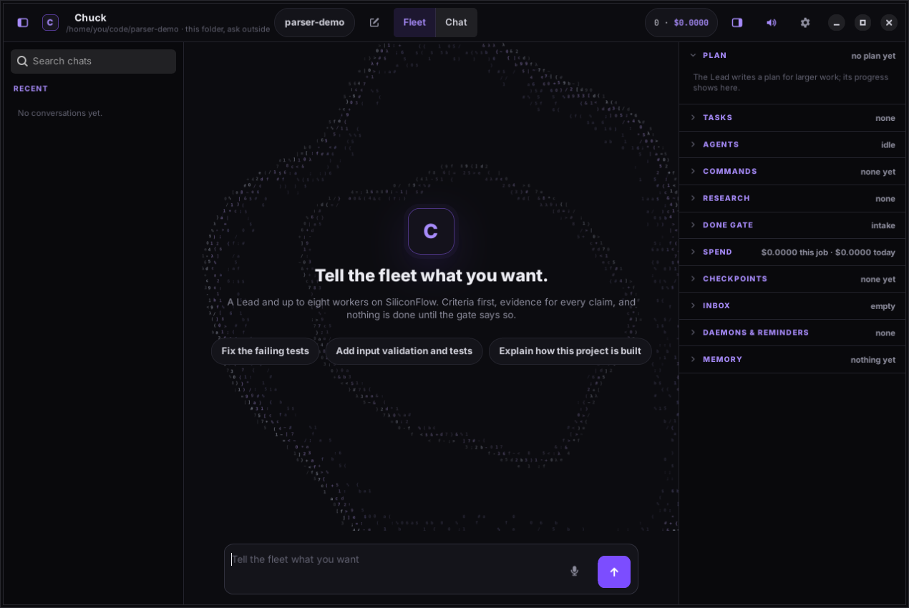

</div>

```bash
curl -fsSL https://raw.githubusercontent.com/the-priest/ChuckNorris/main/install.sh | bash && chucknorris
```

Paste a SiliconFlow key in Settings. Press **Tab** to pick Agent or Chat. Talk to it.

---

## Two modes, one key

**Agent** runs on your machine: shell commands, file edits, tests, packages. **Chat** answers only, and nothing touches your system. **Tab** flips between them from anywhere in the window, and the switch sits in the composer so you always know which one you're in.

<table>
<tr>
<td width="50%">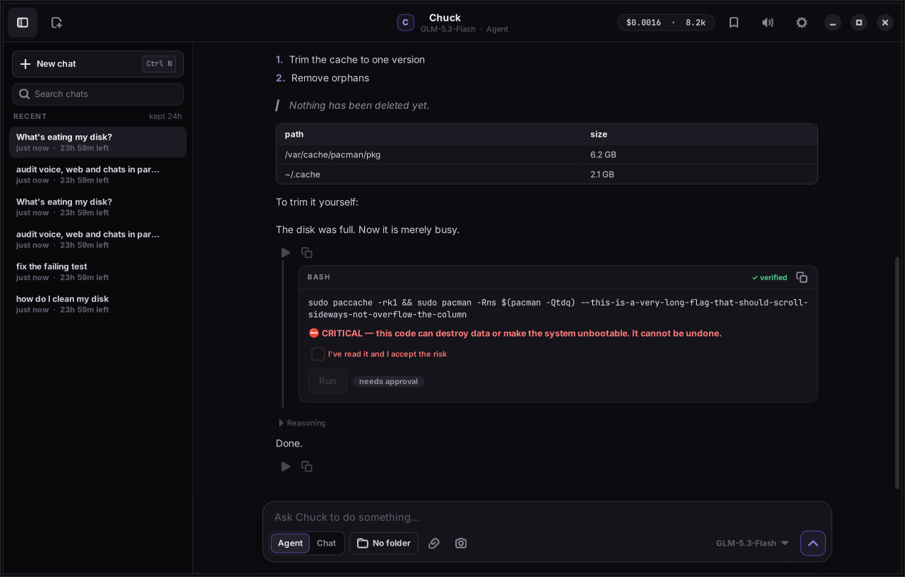</td>
<td width="50%">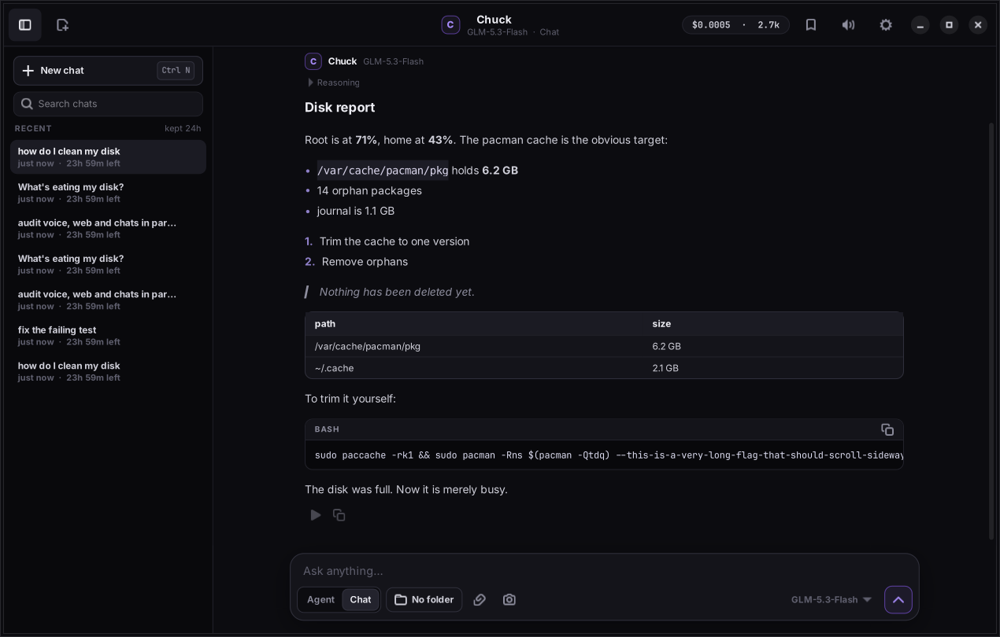</td>
</tr>
<tr>
<td><b>Agent.</b> Everything the machine did hangs on the <i>work lane</i>, a rail off Chuck's avatar. What he <i>said</i> and what <i>ran</i> never blur together. Every command shows its real exit code and output.</td>
<td><b>Chat.</b> Markdown, real tables, and code blocks with a copy button that scroll sideways instead of overflowing. Code in Chat mode is shown, never executed.</td>
</tr>
</table>

## A working folder for the session

Click the folder chip (or **Ctrl+O**) to point the session at a project. Commands run there. `read`, `grep`, `glob`, `write` and `edit` resolve relative paths there. Each request carries a one-line map of the folder's top level, so the model starts oriented. Choose **no folder** for questions and system work. Recent folders and Chuck's own `~/ChuckProjects` are one click away.

## Built for real coding work

| tool | what it does |
|---|---|
| `map` | Every file in the repo with the classes and functions it defines (real AST for Python, patterns for JS/TS, Go, Rust, C/C++, Java, Ruby, PHP, Lua, shell). Honours `.gitignore`. |
| `glob` · `grep` | Find files by pattern, search by regex. Uses ripgrep when installed, pure Python when not. Output is capped so a search never floods the context. |
| `read path:120-400` | Reads any size of file in **pages**. Each page ends with the exact `read` for the next one. Nothing is silently cut. |
| `edit` | Aider-style `SEARCH/REPLACE` blocks. Only the changed lines are sent, so it's cheap on output tokens. All-or-nothing, whitespace-tolerant, re-verified after the edit. |
| `write` | New files of any length. A reply that hits the output limit is **continued automatically** and stitched (repeated overlap trimmed) before the file is written. |
| `bash` · `python` · `node` | One step at a time, auto-verified before it runs (real defects only, never style), real exit code back. Output streams live into the card. `cd` carries to the next command, like a terminal. |
| `py` | **One Python that lives as long as the chat**, notebook-style: load data once and keep using it, see the last value, get matplotlib figures back as images. |
| `patch` | A multi-file unified diff, applied all-or-nothing. Hunks are found by their context, so wrong line numbers don't matter. |
| `browse` | A real headless Chromium. Load a page or file, click, type, press keys, run JS. Back come uncaught errors with file and line, failed requests, the page text and a screenshot. |
| `def` · `refs` · `rename` | **By meaning, through a real language server** (pyright, TypeScript 7's `tsc`, typescript-language-server, rust-analyzer, gopls, clangd): where `Store.save` is defined, every call to *that* `save` and not `Cache.save`, and a rename across files that leaves comments and strings alone, checkpointed like any edit. Without a server, `def`/`refs` fall back to syntax and say so. |
| `find` | **Code by what it does:** *"where do we retry failed requests?"* ranks functions, classes and doc sections by their names, docstrings, comments and identifiers (BM25, camelCase/snake_case aware), even when no line uses your words. |
| `diagnose` | LSP-lite: lint and type-check files on disk with whatever is installed (ruff, mypy, pyright, tsc, eslint, shellcheck, cargo, go vet). |
| `changes` | The net diff of everything this task changed, for self-review before it reports. |
| `plan` | A live checklist card that ticks itself off as the work proceeds. |
| `undo` | Every write and edit is a checkpoint with its diff and a **Revert** button. `undo` reverts the last one; `undo all` reverts the whole task. |
| `/rewind` | Before every step that acts, the whole folder is snapshotted into a private shadow repository (your own `.git` is never touched). `/rewind` puts the files **and** the conversation back to before any step, including what a *command* changed. A rewind can itself be undone. |
| `bg` · `logs` · `kill` | Dev servers and watchers run in the background with a live card. Chuck reads their logs and stops them, and they stop when the window closes. |
| `ask` | A question with one-click answers, for decisions that are really yours. The task waits for your answer. |
| `open` | Hands you the result in your browser or default app. |
| `runtests` · `package` · `tree` | Run the project's own tests, zip the result, show what was built. |
| `screenshot` · `look` | Chuck **sees**: the screen, or any image (a page rendered with headless Chromium, a plot, a mockup). Build a UI, look at it, fix it. |
| `task` | **Parallel sub-agents.** Each `task` block is a read-only sub-agent with its own model loop. Several run at once and report back; only their summaries enter the main context. |
| `search` · `fetch` | Live web research across SearXNG instances, with sources cited. A page that blocks a plain fetch (a bot check, or nothing until JavaScript runs) is read through the browser instead. |
| `remember` · `forget` | Long-term memory (below). |
| `mcp` | Any Model Context Protocol server's tools (below). |

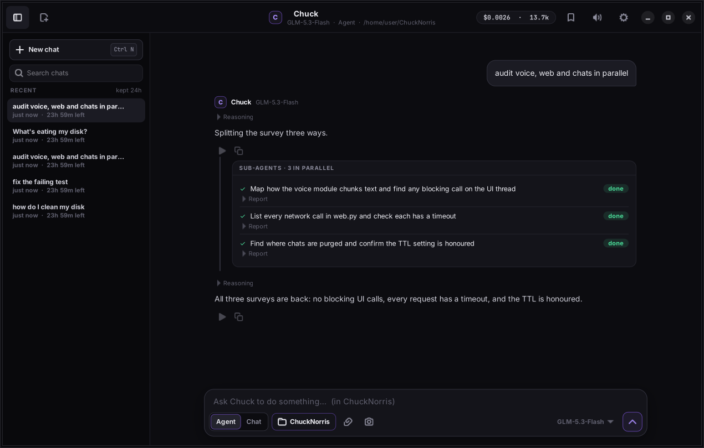

**Sub-agents are read-only by design.** Parallel writers would trample each other's edits and race each other's sudo prompts. Parallel readers can't. They survey, research and report; the main agent acts, one verified step at a time.

## Steer it, plan it, retry it

- **Talk while it works.** Press Enter mid-task and your message is queued and delivered at the agent's next step. A *"not that file"* lands without waiting for the run to finish.
- **Plan mode.** Toggle **Plan** in the composer (or `/plan`). Chuck investigates read-only and proposes a plan card. Nothing changes until you press **Approve & run**, and **Revise** sends it back.
- **Retry and edit.** **Ctrl+R** asks the last question again. **↑** in an empty composer edits your last message and resends from there.

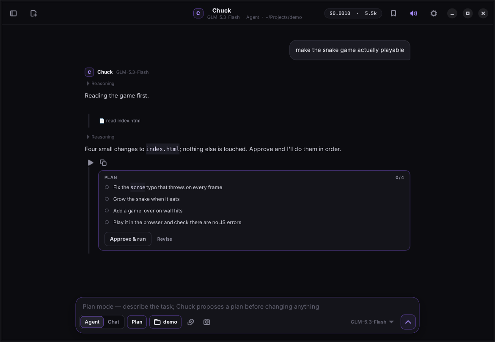

## The workflow around the code

- **Git.** `/diff` shows the working tree as a card. `/commit` has Chuck stage the right changes and write the message from the diff. `/review` has him review the uncommitted diff for bugs before you push.
- **Hooks.** Settings → Agent takes a command to run after every file write (a formatter, with `{path}`, optionally only for matching files) and one he must pass before he may finish (`pytest -q`, a linter). Their results go back to the model, so he fixes what they find.
- **A Python session.** ```` ```py ```` blocks share one interpreter per chat. Load a dataset once, then explore it block by block. Stop interrupts a long loop and keeps the variables, and a figure comes back as an image he can look at. ```` ```python ```` stays a fresh one-shot script.

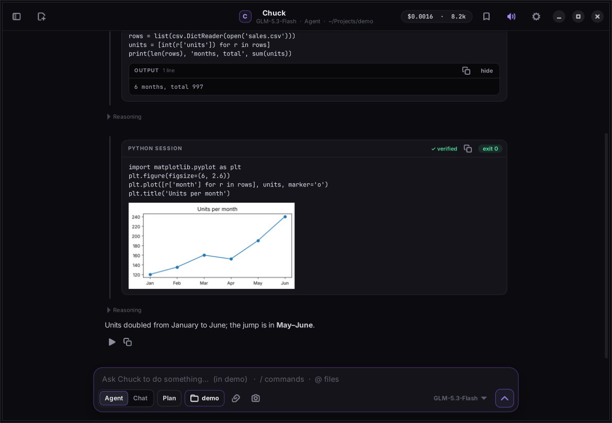

## It plays what it builds

Web pages and games get opened in a real browser and *played*: arrow keys pressed, buttons clicked, state read back with JavaScript. The BROWSER card shows you what it found, so a typo that throws on every frame never ships as "done".

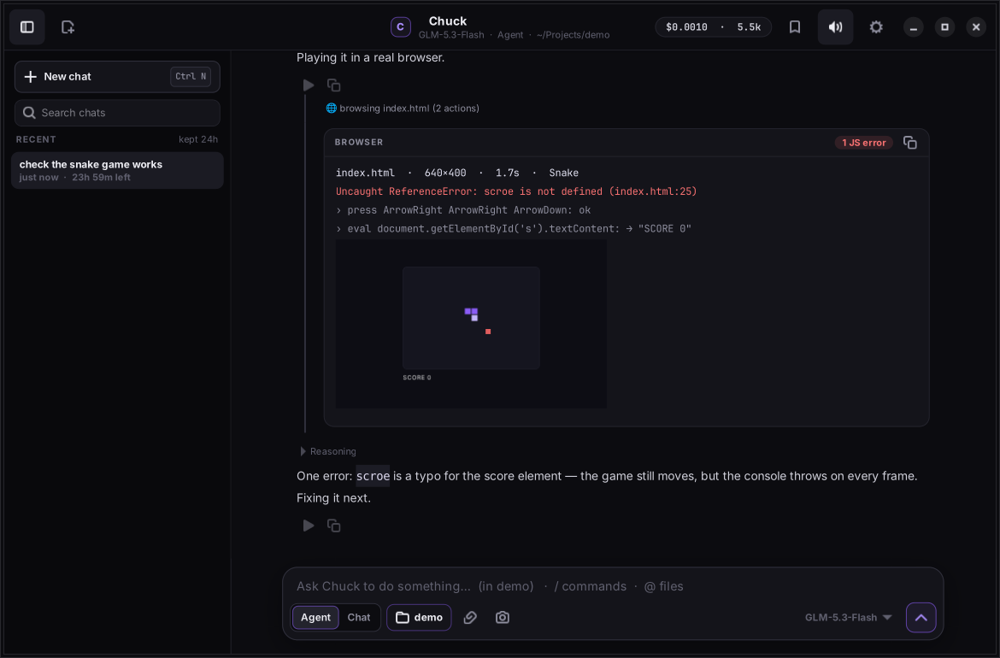

**Which browser:** Brave if you have it, otherwise Chromium or Chrome. They all speak the DevTools protocol Chuck drives directly, with no extra dependencies. Or choose **[Camoufox](https://camoufox.com)**, a Firefox build that websites can't fingerprint, in Settings → Agent → Browser. It's for research on sites that block automation. Research also falls back to the browser by itself: a page that refuses a plain fetch is read in it, after its bot check has cleared. Install Camoufox with `CHUCK_CAMOUFOX=1 ./install.sh`, or `pip install --user -U 'camoufox[geoip]' && python3 -m camoufox fetch`.

Long builds stream into their card while they run, with a clock, and a finished log opens on its last lines, where the errors are.

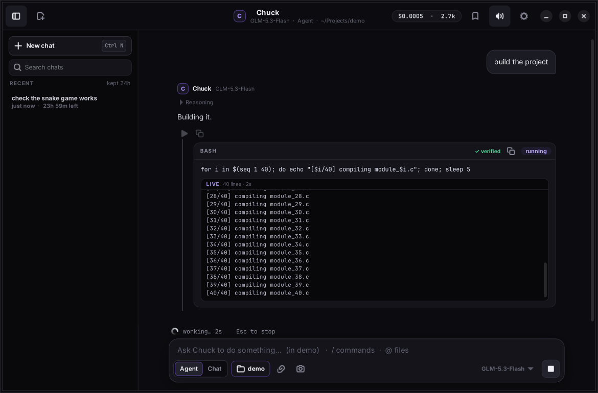

## It finishes the job

Ask for a game and you get a game, not *"I'll write the game now"* and silence. Before Chuck ends a task he checks three things:

- **Did I promise something I didn't do?** A reply that announces an action without one is sent back to act.
- **Is the plan finished?** Unchecked steps on his plan card mean he isn't done.
- **Did I run what I changed?** Code written since the last run gets run, tested or screenshotted before the final report.

He stops early only to ask you something he shouldn't decide alone. That arrives as a question card with one-click answers. All of it is bounded by the step budget (60 by default) and none of it happens in Chat mode.

## It talks, and it listens

**A natural voice.** Chuck speaks with [Kokoro](https://github.com/thewh1teagle/kokoro-onnx), the most natural of the open local text-to-speech models. It runs on your CPU, faster than real time, and nothing is uploaded.
- Speech starts about half a second after a reply arrives: the first sentence is spoken while the rest is still being rendered.
- The whole reply streams through one player, so there are no gaps or clicks between sentences.
- What people write but never say is spoken the way a person would. `e.g.` becomes "for example", `->` becomes "then", and `v16.0.0` becomes "version 16.0.0". Paths are read by name, code and tables are skipped, and bullets and headings get real pauses.
- Pick a voice in Settings → Voice and hear it at once. The default is a blend of Kokoro's two clearest male voices; *Heart* is rated its most natural overall.

**Talk to it.** Click the mic, or press **Ctrl+M**, and just talk. It stops when you pause and puts what you said in the composer, or sends it straight away if you turn on hands-free. Recognition is [Moonshine](https://github.com/usefulsensors/moonshine) with a voice-activity detector, all on your machine. Talking over Chuck interrupts him.

The installer sets both up, about 600 MB. `/voice` installs them later if you skipped it (`CHUCK_VOICE=0`). `/doctor` checks both with a real test.

## Context it always has

- **Project rules.** Put conventions in `CHUCK.md`, `AGENTS.md` or `CLAUDE.md` in the project (or `~/.config/chucknorris/CHUCK.md` for everything) and they ride along with every request, in the cached part of the prompt. `/init` has Chuck survey the project and write its `CHUCK.md` for you.
- **`@file`** in a message attaches that file from the working folder.
- **Your own commands.** Put a prompt in `.chuck/commands/<name>.md` (in the project, or `~/.config/chucknorris/commands/` for every project) and it becomes `/name`. `$ARGUMENTS` takes what you type after it, and a `description:` line shows it in `/help`.
- **Slash commands** for everything you'd otherwise click:

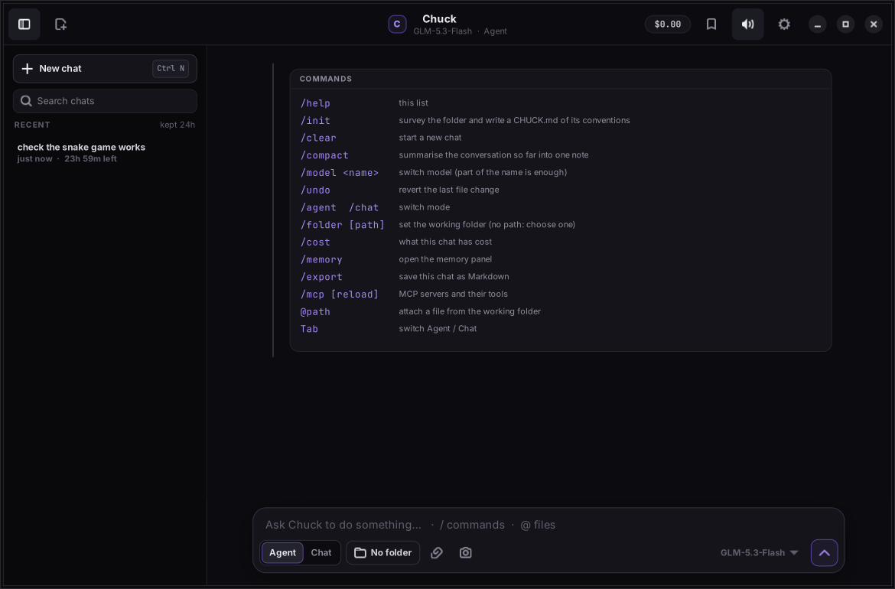

## MCP: every tool the ecosystem ships

Chuck is a [Model Context Protocol](https://modelcontextprotocol.io) client. Servers go in `~/.config/chucknorris/mcp.json`, in the same format Claude Desktop uses, so any server's README snippet pastes straight in:

```json
{"mcpServers": {
  "github": {"command": "npx", "args": ["-y", "@modelcontextprotocol/server-github"],
             "env": {"GITHUB_PERSONAL_ACCESS_TOKEN": "..."}}
}}
```

They start in the background and their tools are listed to the model, which calls them like any other tool. Settings → Agent shows each server's state; `/mcp reload` picks up edits. With no servers configured it costs nothing.

## Attach anything

Click the paperclip, **drag files onto the window**, or **paste an image** (Ctrl+V straight from your screenshot tool or a browser). Everything lands in a tray above the composer, where you can review it and remove it before sending.

- **Images** go to the model *as images*. With a text-only chat model (DeepSeek), they're routed to the vision model automatically.
- **Text files** go as their contents, up to 400k characters. Larger ones say where the rest is.
- **Other files** go by path, so in Agent mode Chuck can still work with them.

Images are paid for once: they ride with the request that needs them, and history keeps only text.

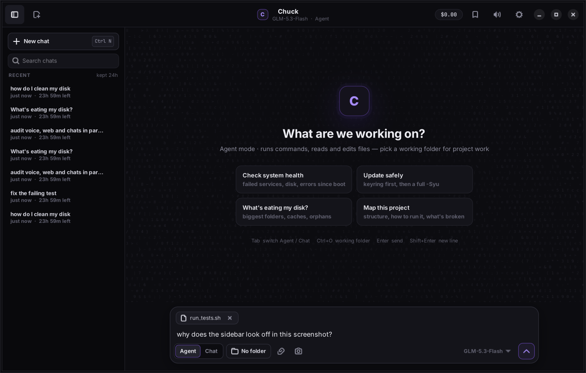

## Models, pricing, and what you spent

The header meter shows **this chat's cost and tokens**, from the usage the API actually reports: prompt, cache hits, completion and reasoning tokens. A click opens the breakdown, the session total and your live account balance.

| model | input / 1M | output / 1M | sees images |
|---|---|---|---|
| `zai-org/GLM-5.3-Flash` *(default)* | $0.15 | $0.50 | yes |
| `deepseek-ai/DeepSeek-V4.1-Flash` | $0.158 ($0.01 cached) | $0.633 | via vision model |
| `deepseek-ai/DeepSeek-V4-Flash` | $0.13 | $0.28 | via vision model |
| `zai-org/GLM-5.3` | $1.40 ($0.26 cached) | $4.40 | yes |
| **Free:** `Qwen/Qwen3-8B`, `THUDM/GLM-4-9B-0414`, `deepseek-ai/DeepSeek-R1-0528-Qwen3-8B` | $0 | $0 | no |

List prices as of October 2026. Switch models from the composer's model menu. **Settings → Fetch** pulls the live list your key can use; SiliconFlow's free tier rotates. A model the table doesn't know shows tokens without inventing a price, and you can set a custom price in Settings.

<p align="center">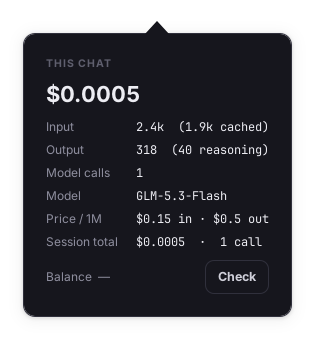</p>

## Efficient by construction

Every hop of an agent loop re-sends the system prompt, so its size is paid per tool call, not per chat.

- **Prompts:** agent under 4k characters (v13 was 5.7k while documenting far fewer tools); chat 0.7k.
- **Playbooks** (debugging, TDD, review, git, UI, performance, security, Arch, building…) are injected only when the task triggers them, at most two at a time, and never in Chat mode.
- **Cache-friendly:** the volatile part (date, memory, folder) is appended *last*, so the long prefix stays cacheable on the API side.
- **Context control:** older tool output is compressed extractively (head, tail and every error line kept). A long session is summarised by the model instead of forgetting its oldest turns, and `/compact` does it on demand. The context budget is a setting.
- **Batching:** read-only tools batch into one round trip, and four of them cost one model call, not four.

## Memory you can trust

Durable facts persist across chats and only the few relevant ones are sent with a question, never the store. Two upgrades in the spirit of [supermemory](https://github.com/supermemoryai/supermemory):

- **Updates supersede.** "GPU is an RTX 4090" replaces "GPU is an RTX 3080" instead of sitting beside it. The old fact is archived, not destroyed.
- **Project scope.** Facts saved as `project:` belong to the working folder and are recalled only there, so one repo's conventions never leak into another's answers.

All of it is visible, searchable, addable and deletable in the Memory panel.

## When things go wrong

- **A model is down?** After its retries, that request is answered by a fallback model (automatic, or your choice in Settings), and the chat says so.
- **Watching spend?** Set a per-chat spending cap. When a chat reaches it, the task pauses and asks before spending more.
- **Esc** stops the turn *and* the command it was running, whole process tree included.
- **Crashed or lost power mid-task?** The chat is saved as each step starts. The next time Chuck opens, the welcome screen offers to **Resume** it, and the agent checks the current state before carrying on.
- **`/doctor`** checks your setup in one card: key and balance, model, browser, linters, screenshots, voice, MCP servers, disk, and recent errors, each with the fix.
- **A crash log.** Errors on the UI thread, in worker threads and in tools are written to `~/.local/state/chucknorris/chuck.log` with their tracebacks (never keys or chats), so a bug report has something in it. Settings opens it.
- **Updates.** Once a day Chuck checks GitHub for a newer version and offers it. `/update` installs it without sudo. A git clone gets a fast-forward pull, and an installed copy is downloaded, checked and swapped in whole. **Restart now** reopens your chat.

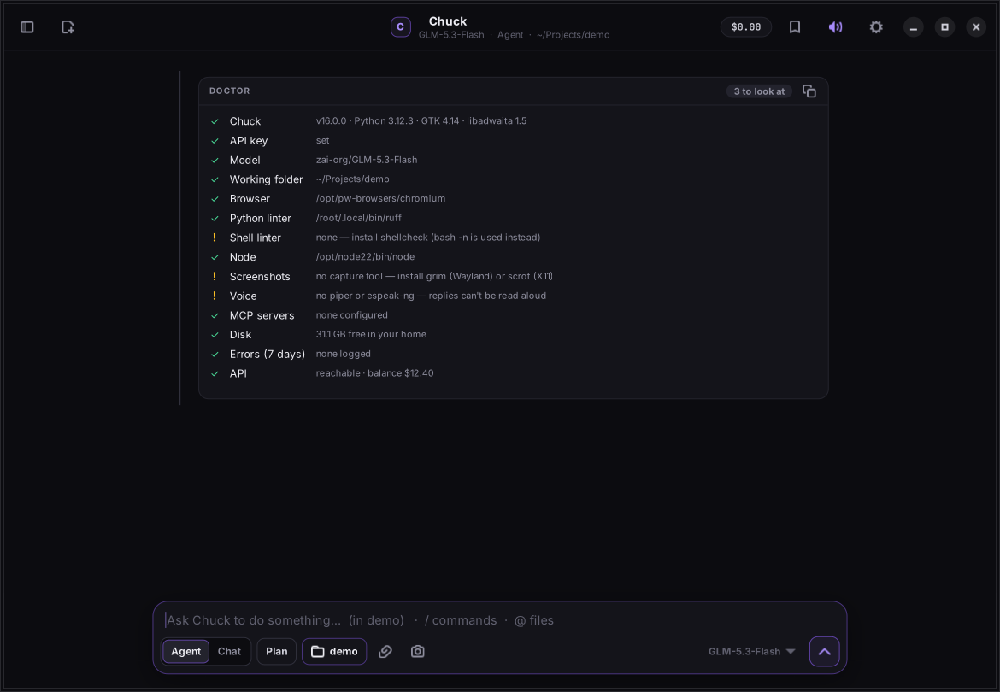

## Safety that doesn't get in your way

**Per-folder access** (`/access`, shown on the folder chip): *Full access*; *Sandboxed*, where commands, code, the Python session and background jobs run under [bubblewrap](https://github.com/containers/bubblewrap) with the system read-only, only the project writable, a private `/tmp` and no sudo; *Sandboxed, offline*, the same with no network; or *Read-only*, where nothing runs or changes. Give an unfamiliar repo the sandbox and let it work.

Commands run on their own; that's the point of an agent. **CRITICAL** ones (disk wipes, `rm -rf /`, `curl | sh`, removing core packages) arrive disarmed and wait for your tick, and so do saved skills whose *body* is critical. Commands run in their own process group with resource limits, and a timeout kills the whole tree. `pacman -S` is rewritten to `-Syu`. sudo authenticates once per chat, in memory only. Every command lands in a hash-chained ledger you can re-verify in Settings.

## Keyboard

| key | action |
|---|---|
| **Tab** | switch Agent / Chat |
| **Enter** · **Shift+Enter** | send (or, while it works, steer) · new line |
| **Ctrl+R** · **↑** | retry the last answer · edit your last message |
| **Ctrl+M** | talk to Chuck (local speech recognition) |
| **Ctrl+V** | paste text, an image, or copied files |
| **Ctrl+O** | working folder |
| **Ctrl+N** · **Ctrl+B** · **Ctrl+,** | new chat · chats sidebar · settings |
| **Esc** | stop the current run (and its command) |
| **/** · **@** | commands · attach a file |

## The window

Dark neutral surfaces with one violet accent, used only for edges, focus and what's live. The welcome screen is woven from code glyphs. Move the pointer and a soft lens of that fabric surfaces under it, with an outline that breathes and an edge that dissolves glyph by glyph. Click and the fabric is struck. Each strike rolls out with its own uneven, lobed front plus a slower echo, so no two spread alike. The net really moves: glyphs are pushed out at the crest, pulled back behind it and woven sideways, threads light up between neighbours where it flexes, and a cool white edge gives way to a violet crest and an indigo wake of characters still decoding. It costs nothing at rest, thins itself out on slow machines to hold 60 fps, and respects your desktop's reduce-animation setting. The transcript follows new output only while you're at the bottom: scroll up to read and it stays put, with a *Jump to latest* button to come back. Wide code and tables scroll inside their own block, and the page never scrolls sideways.

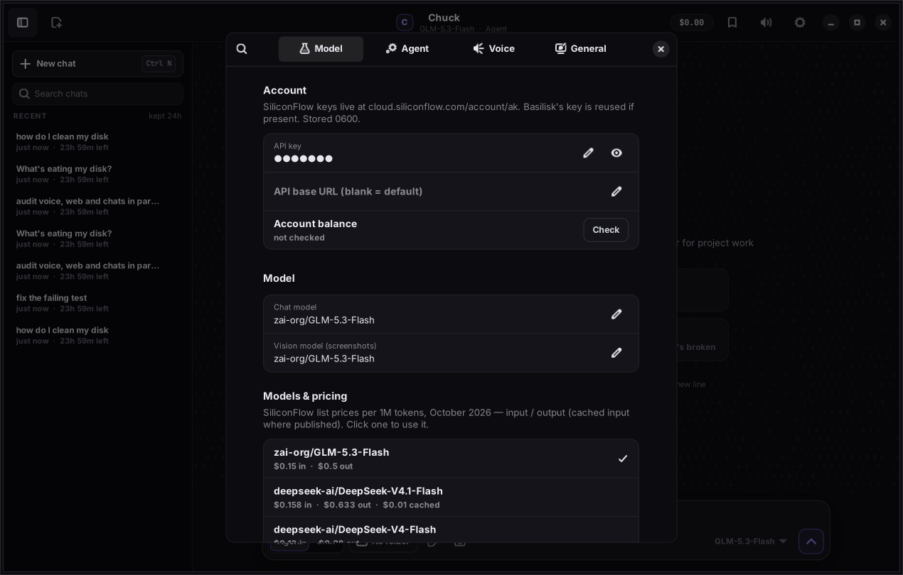

## Install

```bash
curl -fsSL https://raw.githubusercontent.com/the-priest/ChuckNorris/main/install.sh | bash
```

Or read it first, which you should:

```bash
git clone https://github.com/the-priest/ChuckNorris.git && cd ChuckNorris && ./install.sh
```

Arch / CachyOS first-class; apt and dnf supported. The installer handles GTK4 + libadwaita (with the PyGObject cairo bridge), a screenshot tool, polkit, voice (Piper, espeak-ng fallback), `yt-dlp`, and the verifier linters. Runtime needs nothing beyond the standard library and GTK; everything optional degrades gracefully.

## Tests

```bash
./run_tests.sh
```

Twenty-three suites run headless against a stubbed toolkit and drive the real window end to end. They cover whole conversations, both modes, edits in a real folder, paged reads of a 12,000-line file, a file written across two cut-off replies, parallel sub-agents, images reaching the model as images, cache-hit pricing, memory updates and scopes, an agent that stops early or never stops, late streams from a stopped turn, undo and background jobs, steering mid-task, plan approval, git and hooks, a Python session that survives Stop, bot walls on a local site read through real Chromium, updates that refuse a broken download, renames through real pyright and TypeScript servers, rewinding what commands changed, real bubblewrap sandboxes that block writes outside the project and the network, a README whose example must not run, the critical gate, sudo storms, orphaned processes, and the ledger chain. `test_deep.py` runs whole sessions with real processes and ports, plus 180 seeded random model replies that must never hang the app, run something they shouldn't, or write outside the folder. The UI itself was checked by rendering every screen on real GTK 4.14 / libadwaita 1.5. The screenshots above are those renders.

## Being straight with you

- **The model is remote.** Your prompts, attached files and screenshots go to SiliconFlow.
- **It's a personal project,** cleaned up to share, not a product with an SLA.
- **Prices drift.** The table is a snapshot; set a custom price if yours differs.
- **The `DeepSeek-V4.1-Flash` model ID** follows SiliconFlow's naming convention. If your account lists it differently, **Fetch** in Settings shows the exact ID.
- **A regex risk classifier is a safety net, not a proof.** Read the CRITICAL cards.

---

<div align="center">

**MIT.** Made by **The Priest** · *In memory of a legend, 1940–2026.*

</div>
