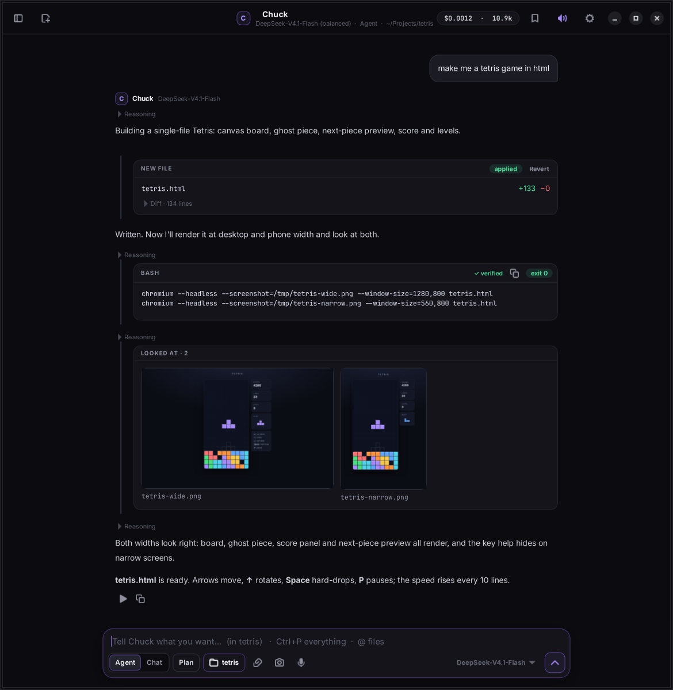
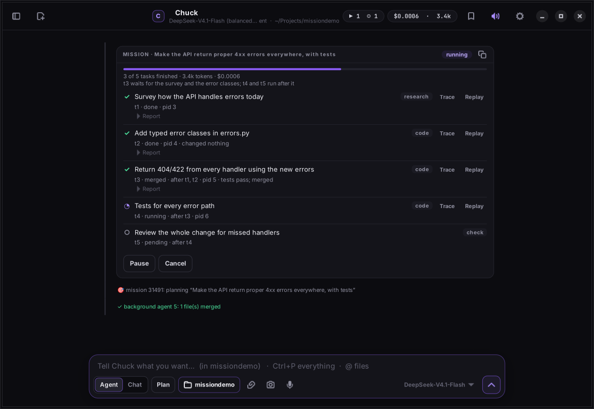
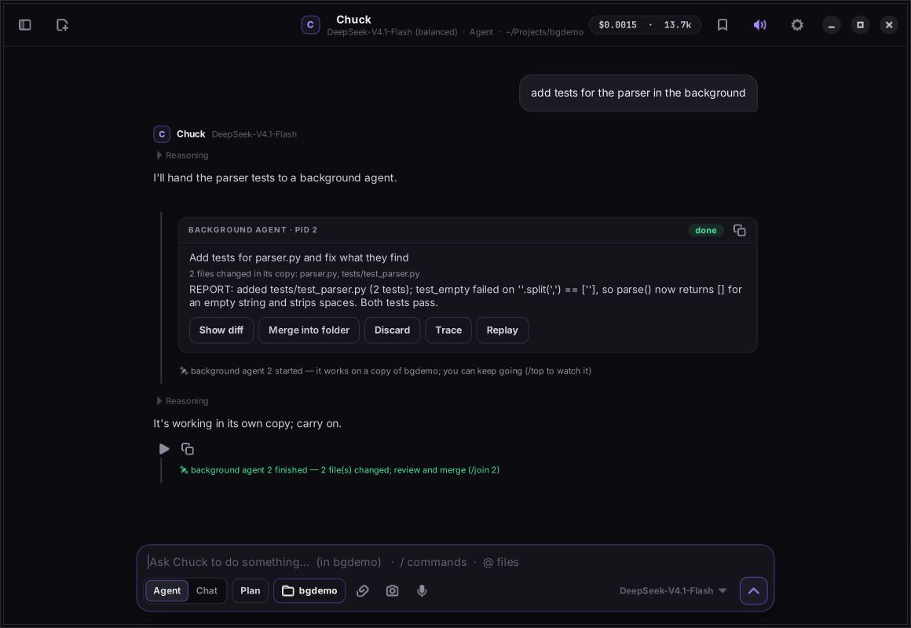
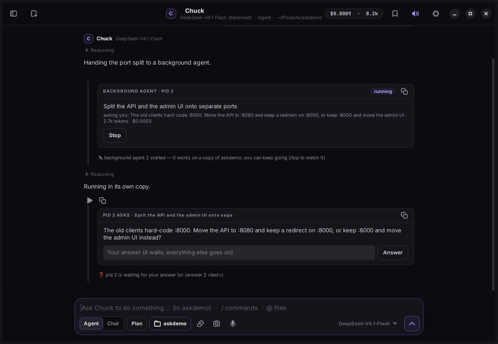
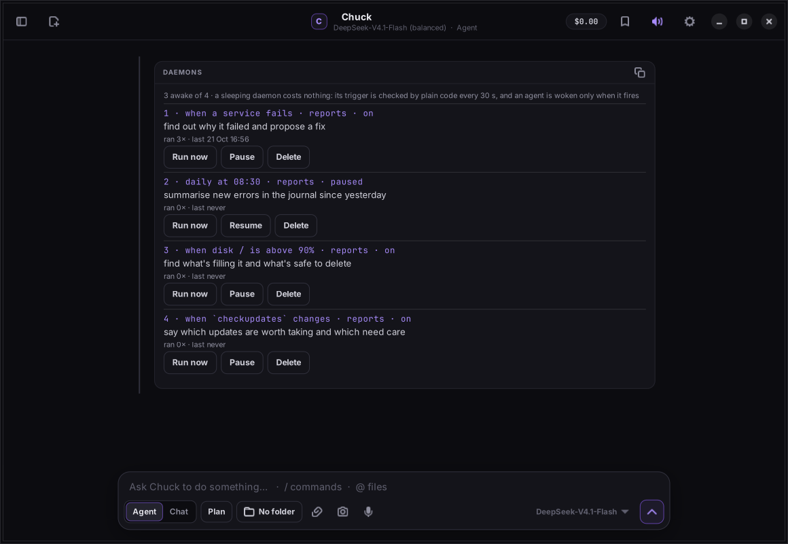
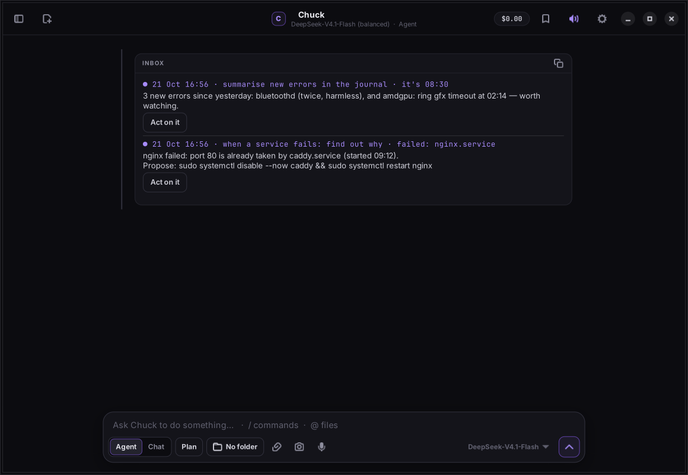
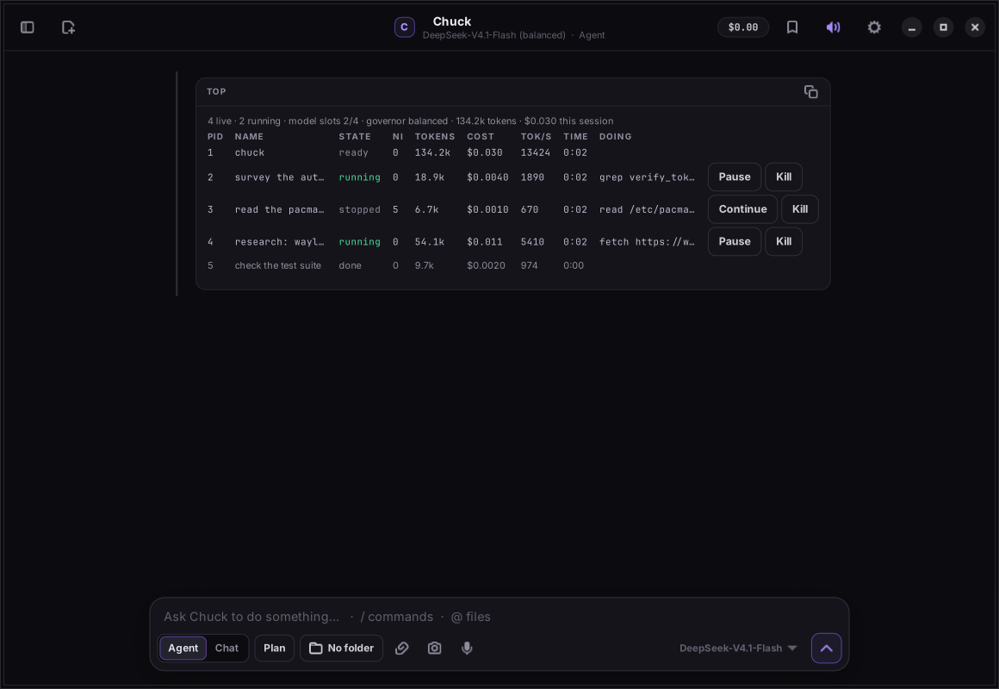
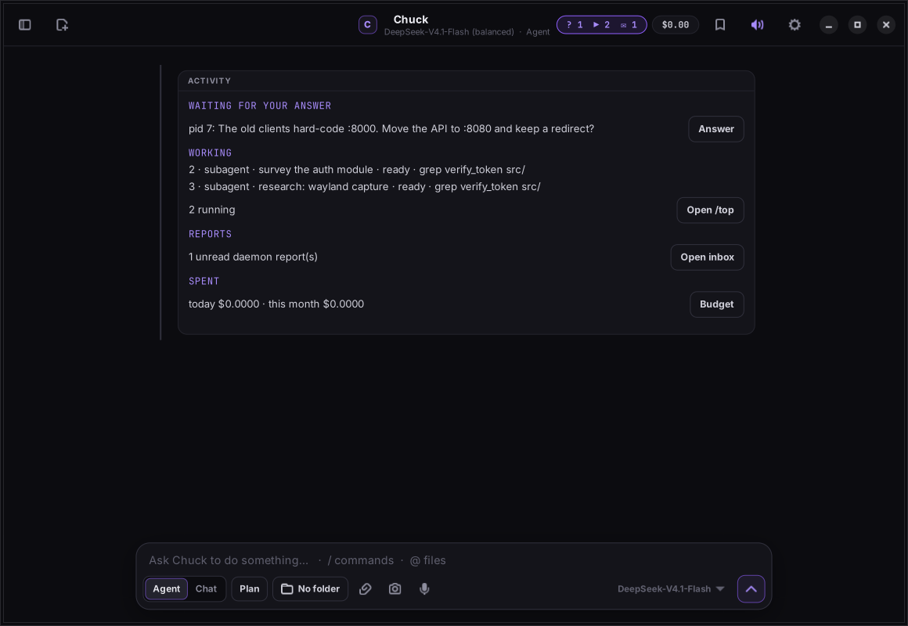
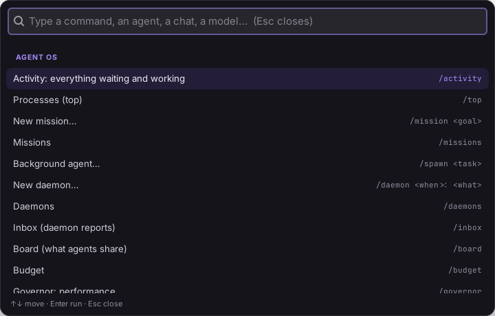
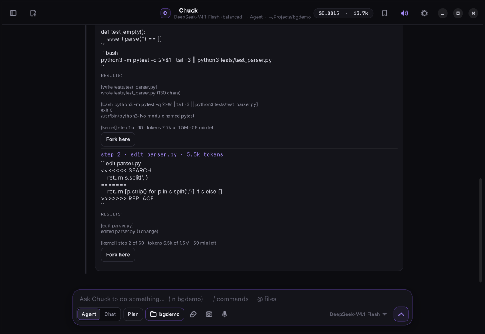

<div align="center">

# Chuck

### The operating system for AI agents.

**Tell it what you want. It plans the work, runs the agents, tests what they change, and keeps to your budget.**

A Linux desktop app where AI agents work on your machine the way programs run on an OS:
as processes with budgets and permissions, in parallel, on safe copies of your code,
asleep until something needs them, and never out of your sight.


</div>

```bash
curl -fsSL https://raw.githubusercontent.com/the-priest/ChuckNorris/rust-rewrite/install.sh | bash && chucknorris
```

Paste a SiliconFlow API key in Settings, pick a folder, and say what you want.

> **You are on the `rust-rewrite` branch.** The one-liner above installs from this branch: the
> Chuck window, plus `chuck`, the new Rust fleet runtime. The rewrite is in progress; see
> [The Rust fleet (preview)](#the-rust-fleet-preview) for what works today.

---

## What is Chuck?

**Chuck is an AI that does the work on your computer, not just one that talks about it.** You say *"my disk is full"*, *"add tests to this project"* or *"why won't Bluetooth start?"*. Chuck runs the commands, reads and edits the files, tests what it changed, and tells you what it did and what it cost. The thinking happens on a model you rent online (SiliconFlow). Everything it *does* happens on your machine, in front of you.

One assistant is easy. The hard part starts when you want several of them working at once, for hours, on real code: something has to decide who goes first, who may touch what, who pays for what, and what happens when one crashes. Computers solved that decades ago with an operating system. Chuck brings the same idea to AI agents:

| a computer has | Chuck has |
|---|---|
| CPU time | **tokens and dollars**, metered per agent, with one daily or monthly limit for everything |
| processes | **agents**, each with an id, a parent, a budget and a live status |
| a scheduler | **model-call slots**, granted by priority, never past a budget |
| permissions | **capabilities** (`read`, `write`, `exec`, `net`, `spawn`) checked on every tool call |
| fork and copy-on-write | **background agents**, each working in its own copy of your folder, merged when you say so |
| `make` and CI | **missions**: a big goal split into a task graph, every merge gated on your tests |
| cron and systemd | **daemons** that sleep for free and wake on a schedule or an event |
| hibernate | **checkpoints** after every step: agents survive a crash and resume |
| RAM and swap | **the context window**, with old tool output paged out and paged back exactly |
| `top`, `strace` | **`/top`** and **`/strace`**, live |

You don't need to know any of that to use it. It works underneath, the way your computer's OS does.

## Just say what you want

There are no commands to learn. Chuck understands what you mean and picks the right tool for the job: it does it itself, hands it to helpers that work at the same time, runs it in the background, or turns it into a mission. It decides what goes first and which model each part runs on. It only stops to ask when the decision is really yours.

| you say | Chuck |
|---|---|
| *"the tests in auth are failing, fix them"* | reads the failure, fixes the code, runs the tests until they pass |
| *"add type hints everywhere, with mypy passing"* | plans a mission, runs the tasks in parallel, merges each one only after its tests pass |
| *"keep working on the parser in the background"* | starts a background agent in its own copy of the folder; you keep talking |
| *"every morning, tell me what went wrong in the journal"* | sets up a daemon that wakes at 8:30, reads the journal and leaves you a report |
| *"remind me at 5 to call the bank"* | a reminder, with a desktop notification; no AI is woken for it, so it costs nothing |
| *"what are my agents doing?"* · *"stop that one"* | shows the activity, or stops the agent |
| *"keep my spending under $2 a day"* | sets the limit. Raising a limit always waits for your click. |

Slash commands, the **Ctrl+P** palette and buttons are all there too, for when you'd rather click.

## Watch it work



Everything the machine does hangs on the *work lane*, the rail under Chuck's name: files written (with a diff and a **Revert** button), commands with their real output and exit code, screenshots it looked at. What Chuck *says* stays in the main column, in the order it happened. Here it wrote a game, rendered it in a real browser at two widths, looked at both, and only then said it was done.

---

## Agents that do real coding work

**Two modes, one key.** **Agent** works on your machine: commands, files, tests, packages. **Chat** only answers, and nothing touches your system. **Tab** switches between them.

**A working folder.** Click the folder chip (or **Ctrl+O**) and point the session at a project. Commands run there and file paths resolve there.

**The tools a good engineer uses:**

| tool | what it does |
|---|---|
| `map` · `find` | A map of every file and what it defines. `find` locates code by what it *does* ("where do we retry failed requests?"), even when no line uses your words. |
| `read` · `grep` · `glob` | Files of any size, read in pages; regex search (ripgrep when installed). Output is capped so a search never floods the context. |
| `edit` · `write` · `patch` | Search/replace edits that send only the changed lines, whole new files, and multi-file diffs, all applied all-or-nothing and checkpointed. |
| `bash` · `python` · `node` | Run one step at a time, checked for real defects before running, with live output and the real exit code. `cd` carries over like a terminal. |
| `py` | One Python session per chat, notebook-style: load data once, keep using it, get plots back as images. |
| `def` · `refs` · `rename` | Code navigation through a real language server (pyright, tsc, rust-analyzer, gopls, clangd): rename a symbol across files without touching comments and strings. |
| `browse` · `look` · `screenshot` | A real headless browser: load a page, click, type, run JavaScript, and get back errors, failed requests and a screenshot that Chuck looks at. |
| `diagnose` · `runtests` · `changes` | Linters and type checkers, the project's own tests, and the net diff of the whole task for self-review. |
| `task` | Read-only helpers that research in parallel; only their summaries enter the conversation. |
| `search` · `fetch` | Web research with sources. Pages that block plain requests are read through the browser. |
| `mcp` | Any [Model Context Protocol](https://modelcontextprotocol.io) server's tools, configured in the same format Claude Desktop uses. |

**It finishes the job.** Before Chuck says "done" it checks that it did what it said it would, that its plan is complete, and that the code it changed was actually run, tested or looked at. Ask for a game and you get a game, played in a browser, not *"I'll write the game now"*.

**You stay in charge while it works.**
- **Steer mid-task.** Type while it works; your message reaches it at its next step.
- **Plan mode.** Chuck investigates read-only and proposes a plan. Nothing changes until you press **Approve & run**.
- **Undo anything.** Every change is a checkpoint. `/rewind` puts the files *and* the conversation back to before any step, including what a command changed. Your own `.git` is never touched.
- **Git built in.** `/diff`, `/commit` (message written from the diff), `/review` (a bug hunt on your uncommitted changes) and `/pr` (branch, commit, tests, push and a written pull request).

<table>
<tr>
<td width="50%"></td>
<td width="50%"></td>
</tr>
</table>

## Many agents at once

### Missions: hand over the whole job

```text
/mission make the API return proper 4xx errors everywhere, with tests
```

A mission turns a goal that's too big for one agent into a small graph of tasks and shows you the plan, with a cost estimate. Then it runs it the way `make` runs a build. Each task starts as soon as the tasks it depends on are finished, several at a time, each in a fresh copy of your folder that already holds the earlier work. **Nothing is merged until the project's tests pass on that copy.** A task that fails its tests is sent back with the failure to fix it; if it still fails, the mission pauses and asks you to retry or skip. The whole mission has one budget, **Cancel** stops every agent in it, and it carries on after a restart. When you ask in plain words, a mission estimated under your auto-start limit ($0.50 by default) begins straight away; bigger ones, and any you start with `/mission`, wait for **Start**.



### Background agents: fork, then merge

A background agent writes, runs and tests code **in its own copy of your folder** while you keep talking to Chuck. Run several; none can trample another. When one finishes, your tests run on its copy and the card tells you whether they pass. **Show diff** lets you pick exactly which files to take, and **Merge** brings them home three-way: your edits and its edits to the same file are combined, and overlapping edits are set aside for you instead of overwritten.



### Agents that talk to each other, and to you

- **Messages.** Tell a working agent something (*"also keep the old port as a fallback"*) and it arrives with its next results.
- **Questions without stopping the world.** A background agent can ask you something in a card and wait, while every other agent keeps going.
- **A shared board** where agents leave notes for each other (*"the tests need Postgres on :5432"*).
- **They know their budget.** Every result tells an agent how many steps, tokens and minutes it has left, so it paces itself instead of being cut off mid-thought.



## Always on, for free

### Daemons: agents that sleep until they're needed

```text
/daemon daily 08:30: summarise new errors in the journal since yesterday
/daemon when a service fails: find out why and propose a fix
/daemon when disk / is above 90%: find what's filling it and what's safe to delete
```

An agent that keeps checking *"is the disk full yet?"* pays for every look. A daemon's trigger is plain code (a clock, a file changing, a failed service, disk usage, a command's output), checked every 30 seconds **at no cost**. Only when it fires is an agent woken, told what happened, and asked to report. Unattended daemons **look but never change anything**: the whole system is read-only to them. Reports land in your inbox with a notification, and **Act on it** hands one to the agent.

<table>
<tr>
<td width="50%"></td>
<td width="50%"></td>
</tr>
</table>

### Talk to it from your editor

Turn on `/watch` and keep coding in VS Code, Neovim, JetBrains or anything else. Write a comment that ends in `AI!` and save:

```python
def total(items):   # make this skip None values AI!
```

Chuck sees it, does it, and removes the marker. End a comment with `AI?` and it answers in the chat instead, changing nothing. Watching costs nothing until a marker appears.

### Or from your terminal

While Chuck is open, running `chucknorris` again talks to the running app, so it works from scripts, cron and git hooks:

```bash
chucknorris --here "the tests in auth are failing, fix them"
chucknorris --mission "add type hints everywhere, with mypy passing"
chucknorris --remind "in 20m: stretch"
chucknorris --top        # what every agent is doing, printed right here
```

## Always in control

- **Ctrl+P** opens a command palette with every action Chuck has: agents, missions, daemons, chats, models, folders and settings. Type a few letters, press Enter.
- **The tray** in the header shows what's going on at a glance: a question waiting for you, agents working, a mission running, a new report. Click it for one card with all of it.
- **`/top`** lists every agent like processes: state, tokens, cost, speed and what each is doing, with Pause, Continue and Kill.
- **Budgets everywhere.** Every agent has a budget, a helper can never spend more than the agent that started it, and a daily or monthly limit (`/budget`) covers everything together. At the limit, Chuck pauses and asks.
- **Replay and fork.** Every step of a background agent is saved. `/replay` walks through a run step by step; `/fork` starts a new agent from any step, with the files exactly as they were then.
- **The governor** runs cheap work (read-only helpers, daemons, summaries) on a faster, cheaper model, with your chat model kept for the work that matters.

<table>
<tr>
<td width="50%"></td>
<td width="50%"></td>
</tr>
<tr>
<td></td>
<td></td>
</tr>
</table>

## Safe by design

An agent that can do real work can also do real damage, so safety is built into the layers underneath, not bolted on:

- **Per-folder access** (shown on the folder chip): *Full access*; *Sandboxed*, where everything runs under [bubblewrap](https://github.com/containers/bubblewrap) with the system read-only and only the project writable; *Sandboxed, offline*, the same with no network; or *Read-only*. Give an unfamiliar repository the sandbox and let it work.
- **Your secrets stay hidden** from sandboxed agents: SSH and GPG keys, cloud credentials, browser profiles, token files and Chuck's own API key.
- **Nothing escapes through git.** In a sandboxed folder, agents can't plant git hooks or settings that would run code later, when *you* use git.
- **The critical gate.** Commands that could wreck the machine (disk wipes, `rm -rf ~`, `curl … | sh`, removing core packages) arrive disarmed and wait for your click. Agents running unattended never get sudo.
- **Everything is reversible.** Checkpoints before every step that changes anything, `/rewind` for files and conversation, and background agents that only touch your folder when you merge.
- **A tamper-evident log.** Every command lands in a hash-chained ledger you can verify in Settings.

## Voice

**Chuck talks** with [Kokoro](https://github.com/thewh1teagle/kokoro-onnx), a natural-sounding voice that runs locally on your CPU. Speech starts about half a second after a reply arrives, and code, paths and tables are read the way a person would read them, or skipped.

**And listens.** Click the mic or press **Ctrl+M** and just talk; it stops when you pause. Recognition is [Moonshine](https://github.com/usefulsensors/moonshine), also fully local. Talking over Chuck interrupts him. **Settings › Voice › Test the microphone** checks your input in one second.

## Context and memory

- **Project rules.** Put your conventions in `CHUCK.md`, `AGENTS.md` or `CLAUDE.md` and they go with every request. `/init` writes one for you.
- **Memory you can trust.** Durable facts persist across chats; a new fact replaces the old one instead of contradicting it, and project facts stay with their project. Everything is visible and editable in the Memory panel.
- **Long sessions don't forget.** Old tool output is paged out of the context and paged back exactly when needed; summarising only happens when even that no longer fits. `/context` shows what the next request will send.
- **Attach anything.** Drag in files, paste screenshots, or `@file` from the project. Images reach the model as images.
- **Your own commands.** A prompt in `.chuck/commands/<name>.md` becomes `/name`.

## Models and costs

The header meter shows this chat's cost and tokens, from the usage the API actually reports. A click opens the breakdown, the session total and your account balance.

| model | input / 1M | output / 1M | sees images |
|---|---|---|---|
| `zai-org/GLM-5.3-Flash` *(default)* | $0.15 | $0.50 | yes |
| `deepseek-ai/DeepSeek-V4.1-Flash` | $0.158 ($0.01 cached) | $0.633 | via vision model |
| `deepseek-ai/DeepSeek-V4-Flash` | $0.13 | $0.28 | via vision model |
| `zai-org/GLM-5.3` | $1.40 ($0.26 cached) | $4.40 | yes |
| **Free:** `Qwen/Qwen3-8B`, `THUDM/GLM-4-9B-0414`, `deepseek-ai/DeepSeek-R1-0528-Qwen3-8B` | $0 | $0 | no |

List prices as of October 2026. **Settings → Fetch** pulls the live list your key can use, and you can set a custom price for any model. Chuck is careful with tokens: small prompts, a cache-friendly layout, cheap edits that send only changed lines, and batched read-only tools.

<p align="center"></p>

## When something goes wrong

- **A model is down?** The request goes to a fallback model, and the chat says so.
- **Closed or crashed mid-task?** Chats are saved at every step, and background agents and missions resume where they were.
- **Esc** stops the current run and everything it started.
- **`/doctor`** checks your setup in one card (key, balance, model, browser, voice, MCP servers, disk) and tells you how to fix each problem.
- **Updates** are offered when a new version is out; `/update` installs it without sudo.

## Keyboard

| key | action |
|---|---|
| **Tab** | switch Agent / Chat |
| **Enter** · **Shift+Enter** | send (or steer while it works) · new line |
| **Ctrl+P** · **Ctrl+K** | command palette |
| **Ctrl+M** | talk to Chuck |
| **Ctrl+O** | working folder |
| **Ctrl+R** · **↑** | retry the last answer · edit your last message |
| **Ctrl+N** · **Ctrl+B** · **Ctrl+,** | new chat · chats sidebar · settings |
| **Esc** | stop the current run |
| **/** · **@** | commands · attach a file |

## Install

```bash
curl -fsSL https://raw.githubusercontent.com/the-priest/ChuckNorris/rust-rewrite/install.sh | bash
```

Or read the installer first:

```bash
git clone -b rust-rewrite https://github.com/the-priest/ChuckNorris.git && cd ChuckNorris && ./install.sh
```

Installed from this branch, the app's own updater stays on this branch. The installer also builds
`chuck` with Rust 1.82 or newer. It uses your Rust if you have it, then your distro's package, and
as a last resort installs rustup into `~/.cargo`. `CHUCK_RUST=0` skips this step.

## The Rust fleet (preview)

`chuck` is the rewrite of Chuck's agent runtime in Rust, built around a fixed team on SiliconFlow:
one **Lead** (DeepSeek-V4.1-Flash) that talks to you, writes the acceptance criteria, plans, reviews
and owns "done", and up to **four DeepSeek and four GLM-5.3-Flash workers**. Each worker is its own
process and thread, working in its own copy of your project.

```bash
cd ~/code/my-project
chuck run "the parser crashes on empty input: fix it and add a test"
chuck models          # are the fleet's models on your account?
chuck key             # save the API key (the window shares it)
```

"Done" is enforced in code, not left to the prompt:

- Nothing changes until acceptance criteria exist, and larger work also needs a plan.
- Every criterion needs evidence: a command and its real output, a test run, or a diff.
- Verification must pass after the *last* change. An edit made after a passing test makes it count for nothing.
- A worker's submission is refused while anything is missing. The Lead re-runs the checks on the
  worker's copy before anything is merged into your folder.
- Leftover TODOs and stubs, or a tiny diff for a large ask, block completion until fixed or justified.
- An independent critic pass reviews the whole result before the Lead can finish.
- Running out of budget ends the job **INCOMPLETE**, with the list of what is missing, never "done".

What isn't ported yet: the Rust window (the window is still the Python app), the bubblewrap sandbox
(`chuck` runs commands directly in the project folder, behind a floor of refused commands like
`sudo` and `rm -rf ~`), checkpoints, missions, daemons and voice. [ARCHITECTURE.md](ARCHITECTURE.md)
has the design and the plan.

Arch and CachyOS are first-class; apt and dnf are supported. The installer sets up GTK4 and libadwaita, bubblewrap, a screenshot tool, the local voice models (about 600 MB, skip with `CHUCK_VOICE=0`) and the linters Chuck uses to check code. At runtime Chuck needs only Python's standard library and GTK; everything optional degrades gracefully when it's missing.

## Tests

```bash
./run_tests.sh
```

Twenty-four suites drive the real application end to end against a stubbed toolkit: whole conversations in both modes, real edits in real folders, background agents merging three-way, missions gated on tests, daemons that must only look, crashes resumed and runs forked from past steps, real bubblewrap sandboxes that must block writes and network, real language servers, and the safety gate against destructive commands. One suite feeds the app 180 random model replies that must never hang it, run something they shouldn't, or write outside the folder. The screenshots on this page are renders of the real app on GTK 4, driven by scripted model replies so they can be reproduced.

## Good to know

- **The model runs in the cloud.** Your prompts, attached files and screenshots go to SiliconFlow. Everything else stays on your machine.
- **Chuck is as good as the model behind it.** Planning, orchestration and code quality depend on the model you choose; the OS makes it safe, metered and recoverable.
- **The safety gate is a net, not a proof.** It catches the destructive commands that matter, and the sandbox is the real wall. Read the cards that ask for your confirmation.
- **Prices change.** The table is a snapshot; set a custom price in Settings if yours differs.
- **It's a personal project,** built with care and shared freely, not a product with an SLA.

---

<div align="center">

**MIT.** Made by **The Priest** · *In memory of a legend, 1940–2026.*

</div>
